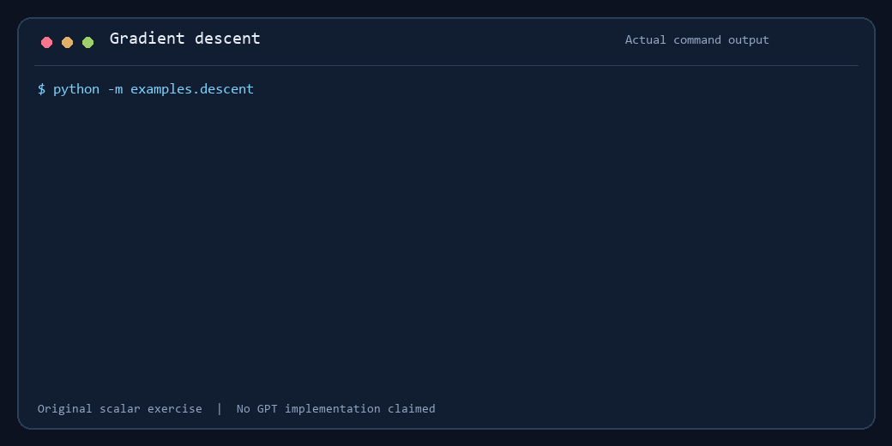

# NeetCode ML Exercises — GPT Scaffold

Learning repository associated with the [NeetCode ML course](https://neetcode.io/practice?tab=coreSkills&topic=Machine+Learning).

**Status: incomplete scaffold.** The checked-in implementation is a scalar gradient descent exercise. A GPT model, tokenizer, training loop, and text generation entry point are not present. This repository does not currently train or generate text.



The animation shows actual output from the included exercise and its tests. [Recording details](docs/record-demo.md)

## What is available

| Path | Current contents |
| --- | --- |
| `foundations/gradient_descent.py` | `Solution.get_minimizer`: gradient descent on `f(x) = x²`, returning the final value rounded to five decimal places |
| `foundations/__init__.py` | Exports the implemented `Solution` class |
| `model/` | Package placeholder for future model code |
| `data/` | Package placeholder for future data code |

The existing exercise implementation is preserved; the repository name describes the learning goal, not a completed GPT implementation.

## Run the existing exercise

Using Python 3.10 or newer, start with a fresh checkout:

```bash
git clone https://github.com/smgpulse007/neetcode-gpt.git
cd neetcode-gpt
python -m examples.descent
```

From an existing checkout, run the walkthrough with `python -m examples.descent`.
To run the single worked example directly from the repository root:

```bash
python -c "from foundations import Solution; print(Solution().get_minimizer(10, 0.1, 5))"
```

Expected output:

```text
0.53687
```

The update is `x_next = x - learning_rate * 2*x`. For this quadratic, a learning rate strictly between 0 and 1 converges toward zero. The exercise assumes a nonnegative iteration count; it does not validate inputs.

No third-party dependencies are needed for this exercise or its tests. The historical `requirements.txt` lists packages intended for the broader ML project; installing them does not supply the missing implementation.

## Verify

```bash
python -m unittest discover -s tests -v
```

Tests cover package imports, the worked example, convergence from either sign, and zero iterations. These checks validate only the included exercise.

## Planned work

- Recover and verify any original course submissions before adding them here, preserving attribution.
- Add model and data components with tests as they become available.
- Add training and generation commands only once they can be run from a clean checkout, with documented data, configuration, and measured results.

No model-quality or training-performance results are claimed for the current scaffold.
